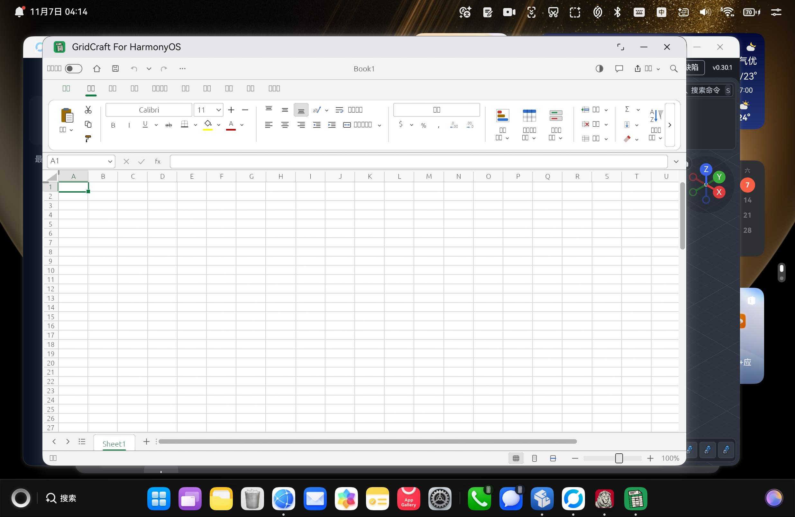

# GridCraft for HarmonyOS（鸿蒙）

把 [GridCraft](https://github.com/storytold/gridcraft) —— 一个纯 Rust + egui 的 **Excel 风格电子表格应用**
——移植到 **HarmonyOS**，产出可在真机上安装运行的 DevEco Studio 工程与 `.hap`。

- **移植对象**：`storytold/gridcraft`（workspace `0.16.0` / edition 2024 / rust-version 1.95），已同步到上游 `main@2c58c76`（2026-11-08，PR #2696）
- **移植方法**：以姊妹工程 `wordcraft-hmos` 为主模板，沿用「ArkTS + C++ N-API + Rust 适配层」三层架构与双 ABI 产物，
  **不 patch 上游**（`SheetApp` 已原生暴露全部宿主缝），仅对 3 处硬编码英文提示做了中文化（补丁见 [`zh_patches.diff`](./zh_patches.diff)）
- **当前状态**：全链路已在 **HPR-W72 / 2in1 / API 26 / Maleoon 916** 真机上安装运行通过：
  双 ABI Rust `.a` → CMake 链接 → ArkTS → HAP 打包 → 专属包名签名 → 真机安装启动全部走通；
  GPU 实时渲染（wgpu **GLES** 后端直绘 `NativeWindow`，不经 eframe/winit），完整电子表格界面上屏
- **软件名称**：显示为 **`GridCraft`**（`AppScope` 的 `app_name`）
- **签名**：独立 bundle `io.github.shaliuxin.gridcraft.hmos`，DevEco 自动签名（AGC 调试 profile），真机安装无 `pkcs7` 校验失败

> 一句话定位：GridCraft 原本跑在桌面；本工程把它搬到鸿蒙，
> 通过 **ArkTS → C++ N-API → Rust 适配层** 三层桥接，渲染走 wgpu GLES 直接画在鸿蒙 `NativeWindow` 上。



---

## 目录

- [功能与状态](#功能与状态)
- [架构（三层）](#架构三层)
- [目录结构](#目录结构)
- [环境要求](#环境要求)
- [构建与安装](#构建与安装)
- [签名说明](#签名说明)
- [已知限制](#已知限制)
- [与 wordcraft 模板的差异](#与-wordcraft-模板的差异)
- [许可与上游](#许可与上游)

---

## 功能与状态

如实区分「已验证」与「首版限制」。完整验证矩阵见 [`移植报告.md` §6](./移植报告.md)。

| 能力 | 状态 | 说明 |
| --- | --- | --- |
| Rust 双 ABI 静态库 | ✅ 已验证 | aarch64 + x86_64 编译通过；13 个 `gc_*` FFI 符号经 `llvm-nm` 核对 |
| CMake 链接 `libgridcraft.so` | ✅ 已验证 | 双 ABI 链接通过，无 undefined `gc_*`；`time_service_ndk`（不能带 `.z`）正确 |
| HAP 打包 + 签名 | ✅ 已验证 | hvigor `assembleHap` 33 个 task 全过，`SignHap` 产出 `entry-default-signed.hap` |
| 真机安装运行 | ✅ 已验证 | HPR-W72 / 2in1 / API 26：`hdc install` → `aa start`，进程稳定、EGL present + Vsync |
| 界面完整上屏 | ✅ 已验证 | 10 个功能区标签（文件/开始/插入/绘图/页面布局/公式/数据/审阅/视图/自动化）、单元格网格、fx 公式栏、Sheet 标签、状态栏 |
| 界面语言 / CJK 字体 | ✅ 已验证 | `zh-Hans-CN` → 简体中文；注入 13 族 CJK 字体后无 tofu 方块 |
| 单元格编辑 / 公式 / 撤销重做 / 导航 / 缩放 | ✅ 已验证 | `=D3+D3` → 84；命名跳转、Tab 切换、滚动命中 |
| 另存为 / 保存写盘 | ✅ 已验证 | `download(name, bytes)` 通道：picker → `fileIo` 写盘 → 回包；取消分支不卡死 |
| xlsx / CSV / PDF / HTML 导出 | ✅ 已验证 | 四条完整日志链（4,004 / 12 / 1,083 / 402 字节） |
| 打开真实 `.xlsx` | ✅ 已验证 | picker 打开 → 沙箱 `.inbox/Book1.xlsx`，标题栏正确 |
| 百分号编码 / 中文文件名 | ✅ 已验证 | `%25E6…` → `文档1.pdf` 正确解码并落盘 |
| 系统「打开方式」回调链 | ✅ 已验证 | `onCreate(want.uri)` + `onNewWant` + `@StorageLink/@Watch`（冷/热启动均接线） |
| 原生打印 | ✅ 已验证 | `services.print` → 沙箱 `print/Book1.pdf` → `print.print([uri], context)`：`StartPrint ret=0`、系统打印页出打印机与「开始打印」 |
| 系统窗口 X 关闭确认 | ✅ 已验证 | `windowWillClose` 拦截 → `Save Changes?` 三按钮（有改动提示、无改动直接退） |
| 剪贴板写（复制） | ✅ 已验证 | `copy_html` → `clipboard_set`，内容落系统剪贴板 |
| 剪贴板读（粘贴） | ⚠️ 权限受限 | `getData` 需受限权限 `ohos.permission.READ_PASTEBOARD`，调试包无法授予（`9568289`）；代码正确，发布包持权限即完整 |
| 首选项持久化 | ⚠️ 首版延后 | 上游跑裸 `egui::Context`（非 eframe），跨启动 `Storage` 不存在；仅 3 个 backstage 选项受影响，详见报告 §6.3 |
| OS 级「保存回原文件」 | ⚠️ 平台限制 | 打开为**只读临时 URI 授权**且文件已复制进沙箱，原文件无写句柄；picker 保存即平台正解，详见报告 §6.4 |
| 粗体字重视觉 | ⚠️ 字体限制 | 鸿蒙无拉丁 bold 面，`CELL_BOLD` 与 `CELL` 同链、egui 不合成粗体；粗体逻辑/导出正确，屏幕字重不变，详见报告 §4.3.1 |
| x86_64 真机 / 模拟器 | ⚠️ 未验证 | 双 ABI 产物已校验，实测仅 arm64 真机 |

---

## 架构（三层）

```
ArkTS (UIAbility + XComponent, libraryname:'gridcraft')
   │  N-API (libgridcraft.so: init/input/reply/open/dropFile/command/attach/resize/detach/frame/active/close)
   ▼
C++ N-API 桥 (entry/src/main/cpp/bridge.cpp, napi module "gridcraft")
   │  链接 libgridcraft_hmos.a；提供 gc_hilog / gc_request_vsync / gc_set_window_color_space
   ▼
Rust 适配层 (native/rust, staticlib "gridcraft_hmos")
   │  path 依赖上游，不 patch 上游
   ▼
gridcraft-ui-egui (SheetApp) + gridcraft-engine + egui/egui-wgpu 0.37 + wgpu 30 (gles)
```

- **FFI 前缀全部 `gc_`**：Rust 侧导出 13 个 `gc_*`；另有 3 个由 C++ 提供（已用 `llvm-nm -u` 核对为 `.a` 中仅有的 undefined）
- 渲染走 wgpu 的 `gles` feature + vendored `third_party/wgpu-hal-30.0.1`（含 GLES uniform-block 修补）
- 主窗口单 XComponent；触摸 / 鼠标 / 键盘 / 手写笔点击均命中

---

## 目录结构

```
gridcraft-hmos/
├─ AppScope/                  # bundleName / 应用名 / 图标
├─ entry/
│  └─ src/main/
│     ├─ ets/pages/Index.ets  # XComponent、文件打开/保存、打印、剪贴板、生命周期
│     ├─ cpp/                 # N-API 桥 + CMakeLists（链接 libgridcraft_hmos.a）
│     └─ module.json5         # 权限：INTERNET + PRINT
├─ native/rust/               # Rust 适配层（staticlib gridcraft_hmos）
│  └─ Cargo.toml              # path 依赖 ../../../gridcraft/crates/{ui-egui,engine}
├─ third_party/wgpu-hal-30.0.1/   # vendored wgpu GLES 后端（离线构建必需）
├─ scripts/
│  ├─ build_native.sh         # 双 ABI 交叉编译
│  ├─ run_on_device.sh        # 构建 → 打包 → 安装 → 启动 一条龙
│  ├─ verify_native.py        # 校验签名 / bundleName / 权限 / 符号
│  ├─ make_icon.py            # 图标生成
│  └─ make_gridcraft_signing.sh / encrypt_pwd.js  # 本地 CA 离线签名（仅自测）
├─ docs/                      # 真机截图
├─ zh_patches.diff            # 3 处「Save Changes?」等提示中文化补丁（相对上游）
└─ 移植报告.md                # 完整移植报告（架构 / 逐项验证 / 限制 / 经验）
```

> **上游源码不在本仓库内**。`native/rust` 通过 `path` 依赖 `../../../gridcraft`，
> 构建前需把上游拷到同级目录：`git clone https://github.com/storytold/gridcraft` 后
> `git apply gridcraft-hmos/zh_patches.diff`（在 `gridcraft/` 内执行）。

---

## 环境要求

| 项 | 版本 |
| --- | --- |
| DevEco Studio | 带 OpenHarmony SDK（API 26）+ native llvm + hvigor |
| Rust | ≥ 1.95（edition 2024），`rustup target add aarch64-unknown-linux-ohos x86_64-unknown-linux-ohos` |
| Python | 3.x（`verify_native.py` / `make_icon.py`） |
| 设备 | HarmonyOS / OpenHarmony 真机或模拟器（2in1 / Pc 形态） |

Windows 交叉编译需一个**无空格**的 sysroot junction，例如 `C:\ohossysroot` → SDK 的 `native/sysroot`
（空格路径会让 `--sysroot` 被 clang 拆断）。`scripts/build_native.sh` 已封装这些细节。

---

## 构建与安装

```bash
DEV="/c/Program Files/Huawei/DevEco Studio"
NODE="$DEV/tools/node/node.exe"
export DEVECO_SDK_HOME="$DEV/sdk"
export JAVA_HOME="$DEV/jbr"
export PATH="$DEV/jbr/bin:$DEV/tools/node:$DEV/tools/hvigor/bin:$PATH"

# 1) Rust 双 ABI release 静态库
bash scripts/build_native.sh          # 默认 arm64 + x86_64，可用 GRIDCRAFT_NATIVE_TARGETS 覆盖

# 2) hvigor 打包（含 SignHap）
"$NODE" "$DEV/tools/hvigor/bin/hvigorw.js" assembleHap --mode module \
  -p product=default -p buildMode=debug --no-daemon

# 3) 校验（签名 / bundleName / 权限 / 导出符号）
python scripts/verify_native.py \
  entry/build/default/outputs/default/entry-default-signed.hap \
  --expected-bundle io.github.shaliuxin.gridcraft.hmos

# 4) 真机
HDC="$DEV/sdk/default/openharmony/toolchains/hdc.exe"
"$HDC" uninstall io.github.shaliuxin.gridcraft.hmos
"$HDC" install entry/build/default/outputs/default/entry-default-signed.hap
"$HDC" shell aa start -b io.github.shaliuxin.gridcraft.hmos -a EntryAbility
"$HDC" shell "hilog -T GridCraft -x"   # tag 过滤用 -T；-t 是日志类型
```

一条龙脚本：`bash scripts/run_on_device.sh`（构建 → 打包 → 卸载重装 → 启动，每步校验）。

---

## 签名说明

- 包名 **`io.github.shaliuxin.gridcraft.hmos`** 为上架唯一标识，**上架后不可更改**；
  切勿借用其它 craft 工程的 profile（会与该包名旧版撞车，报 `9568263 版本降级`）。
- 本机 `build-profile.json5` 由 **DevEco 自动签名**回写，指向 `~/.ohos/config/default_gridcraft-hmos_*.{cer,p7b,p12}`；
  这些材料**不入库**（`.gitignore` 已屏蔽 `signing/`、`*.p7b`、`*.p12` 等）。
- `scripts/make_gridcraft_signing.sh` 生成的是 `issuer=pki_internal` 本地 CA 链，**只能验证打包链路**，
  真机以 `9568257` 拒绝，不能当交付包。

---

## 已知限制

详见 [`移植报告.md` §6](./移植报告.md)。三条评估结论已明确为**非缺陷**：

1. **首选项持久化** —— 上游跑裸 `egui::Context`，跨启动持久化的 `Storage` 在 eframe 里；仅 3 个 backstage 求解器选项受影响，
   工作簿本身走文件保存。要做需给 pinned egui 开 `serde` + 宿主自建文件后端，成本收益不成比例 → 延后。
2. **OS 级保存回原文件** —— 鸿蒙的打开是「只读临时 URI 授权 + 复制进沙箱」，应用对原文件无写句柄；
   save-mode picker 即平台正解。
3. **粗体字重** —— 鸿蒙系统字体里没有拉丁 bold 面，`CELL_BOLD` 与 `CELL` 落到同一条字体链，egui 也不合成粗体；
   粗体逻辑与导出正确，只是屏幕字重不变 → 字体可用性限制。
4. **剪贴板读方向** —— 需受限权限 `ohos.permission.READ_PASTEBOARD`，调试包安装报 `9568289` 无法授予；
   正式发布包持该权限即完整。

---

## 与 wordcraft 模板的差异

照抄模板会踩的坑（完整表见报告 §3）：

- `SheetApp` 而非 `WordApp`；`Session::new()` **无参**，空 session 需补 `session.new_workbook()`
- 字体/语言用 `SheetApp::setup_context_for_language(&ctx, dark, language)`
- 打开是 `app.open_path(path)`，关闭标志是 `app.allow_close`（不是 `quit_requested`）
- **`Services` 完全没有 `host_save`** → 保存必须走 `pick_save=None` + `download(name, bytes)`
- i18n 内嵌源码（`crates/ui-egui/src/i18n/*.rs`），无外部 tsv / 环境变量
- `target_os = "linux"` 会把 `zbus` 编进来（OHOS 同样报 linux）；运行期安全 no-op
- `chrono → iana-time-zone → OH_TimeService_GetTimeZone`，必须链接 `time_service_ndk`（**不带 `.z`**）

---

## 许可与上游

- 上游 GridCraft 为 **Apache-2.0 OR MIT** 双许可，本移植工程沿用同一许可：
  [`LICENSE-APACHE`](./LICENSE-APACHE)、[`LICENSE-MIT`](./LICENSE-MIT)。
- 上游仓库：<https://github.com/storytold/gridcraft>
- 姊妹工程：<https://github.com/shaliuxin/wordcraft-hmos>、<https://github.com/shaliuxin/solidcraft-hmos>
